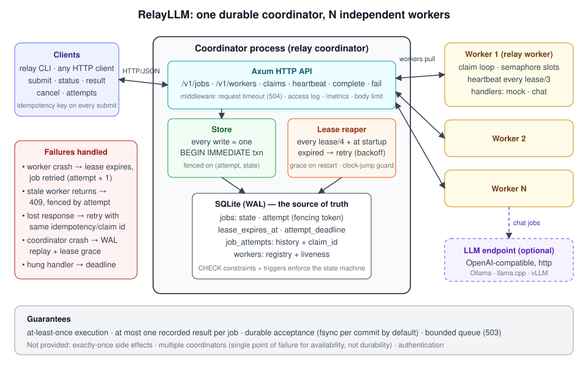
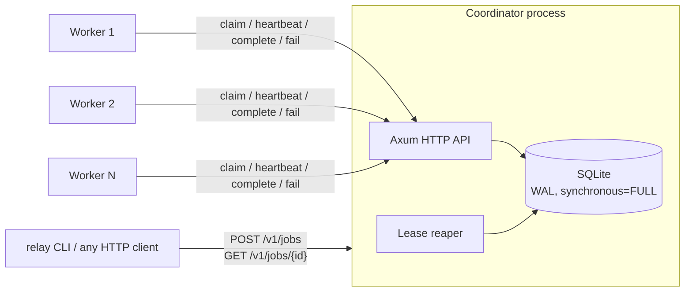
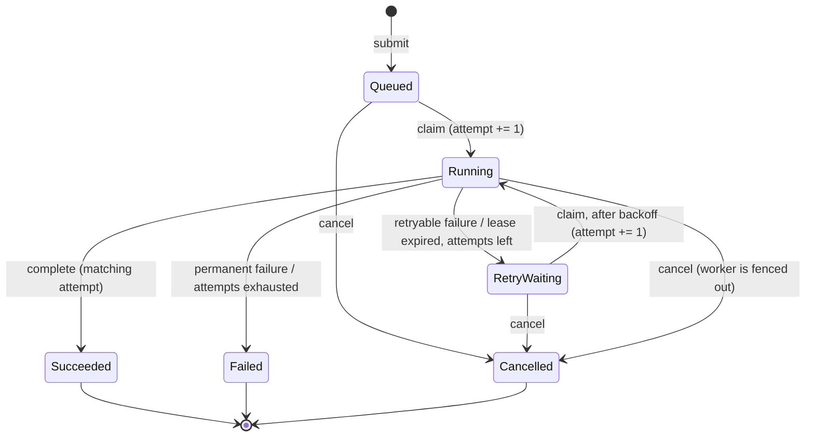

# RelayLLM Architecture

RelayLLM is a durable job queue for LLM workloads: one **coordinator** owns all
job state in SQLite; any number of independent **worker** processes pull jobs
over HTTP, execute them, and report back. A **CLI** submits and inspects jobs.

> Status markers: ✅ implemented · 🚧 designed, not yet built. See `ROADMAP.md`.

## 1. Components





| Crate | Kind | Responsibility |
|---|---|---|
| `relay-core` | lib | Job model, state machine, submission validation, request fingerprints, retry policy, clocks (`MonotonicClock`, `ManualClock`), HTTP DTOs. No I/O. |
| `relay-server` | lib | SQLite store + migrations, Axum routes, claiming, heartbeats, the lease reaper and startup recovery. |
| `relay-client` | lib | Typed Reqwest client for the coordinator API, shared by CLI and workers. |
| `relay-worker` | lib | Worker loop, `JobHandler` trait, deterministic mock handler (OpenAI-compatible handler 🚧). |
| `relay-cli` | bin `relay` | Single installable binary: `relay coordinator`, `relay worker`, `relay submit/status/result/workers/attempts`. |

**Why one binary?** `cargo install --path crates/relay-cli` gives a user
everything. The libraries stay separate so the dependency graph keeps
`relay-core` free of I/O and lets tests drive the server in-process.

**Why `relay-client` exists** (not in the original sketch): both the CLI and
the workers need the same HTTP client. A separate crate avoids two diverging
copies.

**Why migrations live in `crates/relay-server/migrations`** (not repo root):
`sqlx::migrate!` embeds them at compile time, and `cargo package` only
includes files inside the crate directory. The root location would break
packaging.

## 2. Job state machine



The table lives in one place, `JobState::can_transition_to`
(`crates/relay-core/src/job.rs`). Terminal states (`Succeeded`, `Failed`,
`Cancelled`) are absorbing: nothing leaves them. Store operations do not
"set a state". Each one is a conditional SQL update whose `WHERE state IN (...)`
clause lists the legal predecessor states. A write that loses a race touches 0
rows and becomes a typed error. It never overwrites the other write.

## 3. Persistence

SQLite, one file, owned by the coordinator. Settings (`store.rs`):

* `journal_mode=WAL`: readers don't block the single writer.
* `synchronous=FULL`: a `201 Created` means the job is on disk and survives
  power loss, not only a process crash. (`NORMAL` is faster but can lose the
  last commits on power failure. We chose durability over speed.)
* **Two pools.** A *writer* pool of exactly one connection carries every write
  and every `BEGIN IMMEDIATE` transaction. A *reader* pool of read-only
  connections serves everything else. Writers therefore queue in sqlx's async
  FIFO and are woken immediately, instead of colliding inside SQLite and
  sleep-polling in its busy handler. That was the measured bottleneck: the
  split raised `normal` throughput up to 9.8× (`bench/README.md`). Readers
  never wait for the writer in WAL mode, and they see every commit that
  finished before their read began. Nothing may take the writer while
  already holding it; multi-statement writes use the transaction handle.
* `busy_timeout=5s`: still set, because another process or a WAL checkpoint
  can hold the lock.
* All timestamps are **integer milliseconds** from the injected `Clock`. Tests
  use `ManualClock` to expire leases deterministically instead of sleeping.

Schema (`crates/relay-server/migrations/0001_create_jobs.sql`):

* `jobs`: one row per logical job. Its current state, `attempt`
  (fencing token), lease, result and last error.
* `job_attempts` (written from Phase 3): one row per claim, for attempt history.
* (🚧 Phase 2) `workers`: registry plus last heartbeat.

After v0.1 is released, never edit an applied migration: sqlx checksums them
and the coordinator will refuse to start. Add a new numbered file instead.
(0001 was amended once before release, during the 2026-10-27 review. Delete
any database created before that.)

On startup the coordinator resolves `--db` to an absolute path, logs whether
the file already existed and how many jobs it holds per state, and **refuses
to start** unless the connection is actually `journal_mode=wal`,
`synchronous=FULL`. A relative path started from the wrong folder would
otherwise silently create an empty database.

## 4. Submission and idempotency ✅

`POST /v1/jobs` runs **one** SQL statement:

```sql
INSERT INTO jobs (...) SELECT ...
WHERE (SELECT COUNT(*) FROM jobs WHERE state IN ('queued','running','retry_waiting')) < :capacity
ON CONFLICT (idempotency_key) DO NOTHING
RETURNING *
```

* The capacity check and the insert happen in the same write transaction. Two
  concurrent submits can't both see "one slot left".
* `idempotency_key` has a `UNIQUE` constraint. Under any concurrency, at most
  one row per key exists. That guarantee comes from the database, not from an
  in-memory lock.
* If nothing was inserted, the coordinator looks the key up:
  * same **request fingerprint** → `200 OK`, `created: false`, the existing job;
  * different fingerprint → `409 idempotency_conflict` (the key is never
    silently re-bound to a different request);
  * no key / key not found → the queue is full → `503 queue_full` + `Retry-After`.
* The fingerprint is SHA-256 over canonical JSON (object keys sorted
  recursively) of `{kind, payload, max_attempts, timeout_secs}` *as sent*.
  Reordering JSON keys is the same request; changing any value is not. Server
  defaults are deliberately excluded, so changing a default never makes a
  replayed request conflict with its original.
* Keys are retained forever in v0.1 (no TTL). This is documented as a limitation.
* **Lost responses.** If the coordinator commits and the `201` never reaches
  the client, the client can't tell "created" from "never arrived". The only
  safe retry is under the same key. `relay-client` therefore always sends a
  key, generating `auto-<uuid>` for this call when the caller gave none, and
  retries ambiguous failures (transport errors, 500/502/504) with it. `503
  queue_full` is a definite rejection and is *not* retried. A test simulates
  this window by dropping the connection after commit
  (`tests/crash_windows.rs`).
* A key identifies one *logical* job, including one that failed or was
  cancelled. Replaying the key returns that terminal job. To run the work
  again, use a new key.
* Validation runs before the key lookup. If limits are tightened, a replay of
  a previously accepted request may get `422` instead of the existing job.
* The database enforces the job invariants with `CHECK` constraints (result
  ⇔ succeeded, finished ⇔ terminal, `attempt ≤ max_attempts`, owner ⇔
  running, payload is a JSON object). `tests/schema.rs` checks that every
  impossible state shape is rejected.

## 5. Claiming, leases and fencing ✅

Implemented in `crates/relay-server/src/store/claims.rs`. Each of claim,
complete and fail is one `BEGIN IMMEDIATE` transaction that changes the
`jobs` row *and* the `job_attempts` row. A crash, or a dropped request
future, between those writes leaves neither applied. sqlx rolls back a
dropped `Transaction`.

**Claim**, inside that transaction:

1. `UPDATE workers SET last_seen_at … RETURNING kinds`. An unknown worker gets
   `404 worker_not_registered`.
2. **Replay check:** if `job_attempts` already has a row for
   `(worker_id, claim_id)`, return that job while the attempt is still
   current, or `None` if it has ended. Never claim a second job under a reused
   claim id. A `UNIQUE(worker_id, claim_id)` index backs this up.
3. Otherwise claim the oldest eligible job of a registered kind:

```sql
UPDATE jobs SET state='running', attempt=attempt+1, worker_id=:w,
                lease_expires_at=:now+:lease, updated_at=:now
WHERE id = (SELECT id FROM jobs
            WHERE state IN ('queued','retry_waiting') AND available_at <= :now
              AND kind IN (SELECT value FROM json_each(:worker_kinds))
            ORDER BY available_at, id LIMIT 1)
  AND state IN ('queued','retry_waiting')
RETURNING *
```

4. `INSERT INTO job_attempts (job_id, attempt, worker_id, claim_id, started_at)`.

`IMMEDIATE` takes the write lock before step 1, so the subquery's choice can't
be stolen between the read and the write. Two workers cannot both receive the
same `(job_id, attempt)`. `tests/claims.rs` races 10 workers for one job and 60
claims for 30 jobs.

**Complete / fail** update `jobs` `WHERE id=? AND attempt=? AND
state='running' AND worker_id=?`, then close the matching open attempt row.
Exactly one row must match, or the transaction rolls back as corrupt. If the
fenced update matches nothing, the coordinator checks the *attempt history*.
If this worker's attempt already has the same outcome recorded, the report
is a retry of one that landed, and the answer is `200`. Otherwise it is
`409 stale_attempt`. The history check matters: after `fail(attempt 1)` lands
and attempt 2 starts elsewhere, a retried `fail(attempt 1)` must still get
`200`.

**Fencing.** The `attempt` number returned by a claim is the worker's fencing
token. Heartbeat, complete and fail all carry `(job_id, attempt)` and only apply
`WHERE id=? AND attempt=? AND state='running'`.

> *Concrete failure this prevents:* worker A claims job J (attempt 1), then
> stalls in a 40-second GC pause / network partition. Its 30-second lease
> expires; the reaper moves J to `RetryWaiting`; worker B claims it
> (attempt 2) and starts working. A wakes up and POSTs its result for
> attempt 1. Without fencing, A's stale answer would land, and B's later
> answer would overwrite it, or B's write would be rejected. With fencing,
> A's update matches 0 rows → `409 stale_attempt`. A drops the result.

**Leases and deadlines** ✅ (`store/leases.rs`). A claim sets two times:

* `attempt_deadline = now + timeout_ms + deadline_grace`, fixed for the
  attempt. Triggers enforce "set iff `running`" (migration 0003).
* `lease_expires_at = MIN(now + lease, attempt_deadline)`.

Workers heartbeat every `lease / 3`; the coordinator sends this interval in
the assignment. A heartbeat sets
`lease = MAX(lease, MIN(now + lease, attempt_deadline))`. It never shortens a
lease and never extends one past the deadline. It is fenced exactly like
complete/fail, and a `409` tells the worker to **abort the handler**: another
attempt owns the job, so finishing would only waste compute (and money, for
paid APIs).

Lease expiry is judged only by the *coordinator's* clock. Workers never
compare deadlines against their own clocks, so clock skew between machines
cannot cause two owners. The lease is a *trigger* for recovery, not the
ownership check. Ownership is `state='running' AND attempt=:token`. A late
heartbeat or completion from the current attempt is accepted if the reaper
hasn't acted yet, because nobody else has the job.

**The reaper** ✅ (`reaper.rs`) runs every `lease / 4` (50 ms–5 s), plus once
immediately at startup. Each pass is one `BEGIN IMMEDIATE` transaction over up
to 500 jobs with `lease_expires_at < now`. Each row is fenced on
`(attempt, state, lease)`, moved to `retry_waiting` (with backoff) or `failed`
(attempts exhausted), and its attempt row is closed as `lease_expired`, with a
reason that distinguishes "stopped heartbeating" from "attempt deadline
exceeded". Concurrent passes are safe: `tests/leases.rs` runs four at once and
each job is reaped exactly once.

**Retry backoff** ✅ (`relay_core::retry`): `available_at = now +
min(base·2^(n-1), max)`, with equal jitter into `[d/2, d]`. It applies to both
reported retryable failures and reaped leases. Defaults are 1 s base and 60 s cap.

**Startup sequence** (`relay coordinator`), whose order matters:

1. Open the DB and apply migrations.
2. Raise the clock floor to the newest timestamp in the DB (§5.1 #6).
3. **Grant lease grace**: every running job gets `lease = MAX(lease, now +
   lease_duration)` (§5.1 #5).
4. Spawn the reaper, whose first pass runs immediately.
5. Start serving HTTP.

If step 4 ran before step 3, every job whose worker was alive but hadn't
reconnected yet would be re-run. The process-level test
`coordinator_crash_keeps_results_and_in_flight_work` kills the coordinator
mid-job, keeps it down for 2.5 leases, and checks that the job finishes as
attempt 1. With step 3 disabled, it finishes as attempt 2, deterministically.

**Measured recovery** (Windows 11, debug build, 1 s lease): a hard-killed
worker's 1.5 s job was finished by another worker about 2.7–2.9 s after the
kill. That is about 1.2–1.4 s to detect and recover (lease + reaper tick +
backoff) plus the re-run.

### 5.1 Crash windows the Phase 2/3 code must close

Status: all six are implemented and tested. #1, #2 and #4 were done in
Phase 2; #3, #5 and #6 in Phase 3.

These came from the 2026-10-27 review (`docs/reviews/`). Each one is a
moment where a crash or lost packet between two steps breaks a naive design.

1. **Claim committed, response lost.** The coordinator commits `attempt=1`
   to worker W, but the response never arrives. W never runs the job.
   Nobody heartbeats, the lease expires, and one attempt is burned for
   nothing. Repeat that and a healthy job lands in `Failed`. **Rule:** a claim
   request carries a worker-generated `claim_id`, stored on the job. A
   retried claim with the same `(worker_id, claim_id)` returns the *same*
   assignment instead of claiming another job.
2. **Completion committed, response lost.** W's `complete(attempt=2)`
   commits, the response is lost, and W retries. The job is now `succeeded`,
   so the conditional update matches 0 rows. A naive server answers
   `409 stale_attempt`, and W logs a false failure. **Rule:** `complete` is
   idempotent per attempt. If the job is already `succeeded` *with the same
   attempt*, return `200`. Only a different attempt gets `409`.
3. **Hung handler, live heartbeats.** The handler deadlocks, but the
   worker's heartbeat task keeps renewing the lease, so the job is stuck in
   `running` forever and `timeout_secs` is meaningless. **Rule:** the
   coordinator enforces an absolute per-attempt deadline. A heartbeat may
   extend the lease to at most `claimed_at + timeout_ms + grace`, so a
   stuck attempt expires even while heartbeats continue.
4. **Multi-row writes split by a crash.** A claim updates `jobs` *and*
   inserts into `job_attempts`. If the coordinator crashes between those two
   statements, history and state disagree. **Rule:** claim, complete, fail
   and reap each run as one `BEGIN IMMEDIATE` transaction. `IMMEDIATE`, not
   the default `DEFERRED`: a deferred transaction that reads and then writes
   can fail with `SQLITE_BUSY_SNAPSHOT`, which the busy timeout won't retry.
5. **Coordinator downtime looks like worker death.** The coordinator is down
   for 2 minutes with a 30-second lease. Healthy workers can't heartbeat. On
   restart, every running lease has expired, and an immediate reaper pass
   would requeue every in-flight job and execute all of them twice.
   **Rule:** on startup, extend every running lease to
   `now + lease_duration` *before* the first reaper pass. That gives live
   workers one lease period to check in.
6. **Wall-clock jumps.** Leases are persisted wall-clock times, because they
   must survive a restart, so an NTP step forward expires leases early. The
   result is duplicate execution, which fencing keeps safe but is wasteful.
   **Rule:** the coordinator clock is made non-decreasing within a process,
   and the startup grace period above also absorbs jumps across restarts.
   **As built:** `MonotonicClock` wraps the system clock, and its floor is
   raised at startup to the newest timestamp in the database. The reaper also
   compares wall-clock time against the OS monotonic clock between ticks. If
   wall time ran ahead by more than `max(lease, 5 s)`, it grants grace instead
   of reaping.

### 5.2 The protocol over time

Happy path. Every arrow into SQLite is one `BEGIN IMMEDIATE` transaction:

```mermaid
sequenceDiagram
    autonumber
    participant C as Client
    participant K as Coordinator
    participant D as SQLite
    participant W as Worker
    C->>K: POST /v1/jobs {idempotency_key}
    K->>D: INSERT … ON CONFLICT DO NOTHING (capacity check inline)
    K-->>C: 201 {job: queued}
    W->>K: POST /v1/workers/W/claims {claim_id}
    K->>D: job → running, attempt = 1, lease, deadline; insert attempt row
    K-->>W: 200 Assignment {attempt: 1, heartbeat_interval_ms}
    loop every lease/3 while the handler runs
        W->>K: POST …/attempts/1/heartbeat
        K->>D: lease = MAX(lease, MIN(now+lease, deadline)) WHERE attempt = 1
        K-->>W: 200
    end
    W->>K: POST …/attempts/1/complete {result}
    K->>D: job → succeeded WHERE attempt = 1 AND state = running; close attempt row
    K-->>W: 200
    C->>K: GET /v1/jobs/{id}/result
    K-->>C: 200 {state: succeeded, result}
```

Worker crash and a stale return. The attempt number fences the zombie out:

```mermaid
sequenceDiagram
    autonumber
    participant A as Worker A
    participant K as Coordinator + reaper
    participant B as Worker B
    A->>K: claim → attempt 1
    Note over A: process killed / partitioned (no more heartbeats)
    Note over K: lease_expires_at < now → reaper:<br/>attempt 1 = lease_expired, job → retry_waiting (+ backoff)
    B->>K: claim → attempt 2
    B->>K: complete attempt 2 → 200 (job succeeded)
    A->>K: complete attempt 1 (late)
    K-->>A: 409 stale_attempt (attempt row says lease_expired)
    Note over A: result discarded; a heartbeat 409 would abort the handler
```

### 5.3 Cancellation, timeouts and shutdown ✅ (Phase 4)

**Cancellation** (`store/cancel.rs`) is one `BEGIN IMMEDIATE` transaction:
read the job, then do a fenced update to `cancelled`; for a running job, also
close the attempt as `cancelled`. Because cancel and complete/fail all take
the write lock and check the current state, a race has exactly one winner,
and the loser gets a typed `409`. The worker learns about a cancelled
running job at its next heartbeat (`409`) and aborts the handler. So a
running job is cancelled *at once in the database*, but its compute stops
within one heartbeat interval.

**Request timeout** (`observe.rs`, default 10 s, well under the lease)
wraps every route, including body reading. A timeout is `504`, not `503`,
because it is *ambiguous*. Dropping the handler doesn't un-queue a statement
already handed to SQLite. `tests/ops.rs` holds the write lock from another
connection, gets a `504`, releases the lock, and observes that the "timed
out" INSERT committed anyway. Clients must therefore retry idempotently,
which `relay-client` does.

**Shutdown.** Ctrl-C or SIGTERM (Unix, i.e. `docker stop`):

1. Stop accepting connections.
2. Let in-flight requests finish for up to `--shutdown-drain-secs`.
3. Abort the reaper; it is idempotent, so a half-finished pass is fine.
4. Close the pool, bounded to 2 s, because `close()` waits for connections
   stuck in SQLite's busy wait.

Cutting anything off is safe: every write is atomic, and every client
operation is retry-safe.

**Observability.** One middleware logs each request with its *route
template* (`/v1/jobs/{id}`), status and latency, and never the body. It logs
at `debug` for 2xx (workers poll constantly), `info` for 4xx and `warn` for
5xx. `/metrics` serves Prometheus text. Job and attempt counts come from the
database, so they are correct across restarts. HTTP counters are in-process.

## 6. Delivery semantics

RelayLLM provides **at-least-once execution, exactly-once result recording per
attempt.**

* A job may **execute** more than once. Example: a worker finishes an LLM call,
  then crashes before its `complete` request reaches the coordinator. The lease
  expires and another worker runs the prompt again. For a paid LLM API that
  means paying twice. For any handler with external side effects (sending
  email, writing to another DB), the handler must be idempotent itself, for
  example by passing the job id as an idempotency key downstream.
* At most **one** result is ever recorded per job, and only by the attempt that
  currently holds the lease.
* Exactly-once execution is impossible here without the side-effecting system
  participating in a transaction with the coordinator. We do not claim it.

## 7. Correctness risks (and the mitigation for each)

| # | Risk | Mitigation |
|---|---|---|
| 1 | Zombie worker commits a stale result | Attempt-number fencing on every write (§5) |
| 2 | Two workers claim the same job | Single-statement conditional claim; SQLite single writer |
| 3 | Clock skew between machines | Only the coordinator clock judges leases; workers heartbeat on the coordinator's interval |
| 3b | Wall clock steps backwards / forwards | `MonotonicClock` with a DB-derived floor; forward-jump detection grants grace |
| 3c | Hung handler kept alive by heartbeats | Absolute per-attempt deadline caps every lease |
| 3d | Coordinator outage mistaken for worker death | Lease grace granted before the first reap pass |
| 4 | Duplicate side effects | Documented at-least-once semantics (§6); handler-level idempotency |
| 5 | Concurrent duplicate submits | `UNIQUE(idempotency_key)` + `ON CONFLICT DO NOTHING` |
| 6 | Acknowledged job lost on crash | `synchronous=FULL`, ack only after commit |
| 7 | Cancel vs. complete race | Both are conditional on `state='running'`; first commit wins, loser gets `409` |
| 8 | Overload / unbounded memory | Queue capacity in the insert; bounded worker concurrency (semaphore); body-size limit |
| 9 | Workers hammer a dead coordinator | Exponential backoff with jitter in the worker poll loop; no task per retry |
| 10 | `SQLITE_BUSY` on deferred-transaction upgrade | Prefer single statements; multi-statement writes use `BEGIN IMMEDIATE` |
| 11 | SQLite file on a network/sync drive (OneDrive, SMB) breaks locking | Documented: keep the DB on a local disk |

## 8. Trust model

v0.1 has **no authentication**. It assumes a trusted local network (one
machine or a private Docker network). Bind the coordinator to `127.0.0.1`
(the default) unless you put it behind an authenticating proxy. Prompt contents
are never logged. Logs carry job ids, kinds, states and sizes.

The dashboard endpoints follow the same rule: events and snapshots carry job
summaries only (no payload, result or idempotency key), and the one
destructive control, `--dev-controls`, is refused unless the bind address is
loopback.

## 9. Observers: snapshot + event stream

The dashboard (`dashboard/`) must show real state without polling every
table. Design:

* **Publish after commit, from the store.** Each `Store` method that applies
  a transition publishes one `DashboardEvent` after `COMMIT` succeeds:
  never for a rollback, a fenced-out (`stale_attempt`) report, or an
  idempotent replay. Emission lives next to the SQL, not in HTTP handlers, so
  the reaper and the dev control publish too.
* **`seq` + `epoch`.** An in-process `EventBus` assigns `seq` under one lock
  together with the broadcast send, so subscribers see `seq` in order and
  contiguous. `epoch` is a fresh id per process; nothing is persisted.
* **Transitions, not states.** Job events carry `from`. Commits and
  publications aren't one atomic step, so two back-to-back commits can be
  published in reverse; the `from` check turns that into a detected anomaly
  instead of a wrong count.
* **Snapshot `seq` is read before the data**, and the data is read in one
  read transaction. Every event ≤ snapshot `seq` is therefore reflected;
  later ones may be, and clients tell them apart by `from` and
  `updated_at_ms`.
* **Failure mode is "resync", never "guess".** Lag (broadcast capacity
  1,024), restart, gaps and misfits all lead the client to a fresh snapshot.
  A visible `ping` every 5 s lets it notice silent connection loss.
* **Worker health is derived from `workers.last_seen_at`**, which the
  coordinator updates on every claim, claim poll and heartbeat. The browser
  never infers a crash from its own missing events.

Cost on the hot path: one mutex acquisition and a `broadcast::send` per
committed transition. Heartbeats publish too (the dashboard hides them by
default).

## 10. Durable workflows (v0.2)

Specified in full in [`docs/WORKFLOWS_DESIGN.md`](docs/WORKFLOWS_DESIGN.md).
In one paragraph: a run is an immutable definition plus an append-only
event history (`workflow_runs`, `workflow_events`). The pure
`relay-core::workflow::{fold, decide}` turn history into commands. A
single decider task executes them in one `BEGIN IMMEDIATE` transaction per
run. Activities are ordinary jobs, and every terminal job transition
(complete, fail, reap, cancel) appends its workflow event in that same
transaction. That turns the classic "job done but workflow didn't hear"
crash window into an impossibility. Restart recovery is the decider's first
pass.
