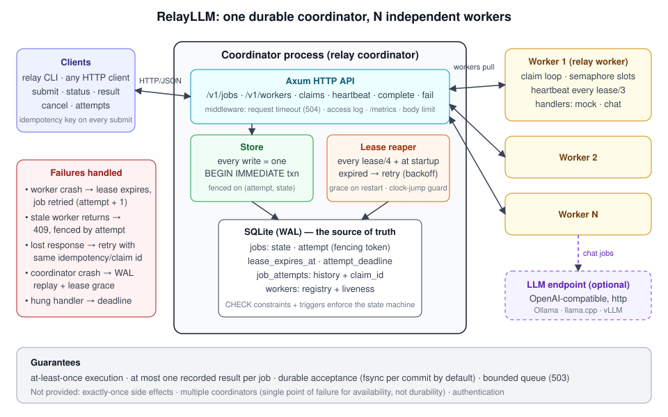

# RelayLLM

> **Work in progress.** RelayLLM is under active development. Interfaces,
> commands and the storage format may still change, and there is no
> released version yet.

RelayLLM is a fault-tolerant job queue for LLM workloads, written in Rust.

A single **coordinator** accepts jobs over HTTP and stores them in SQLite.
Separate **worker** processes claim jobs, run them (for example, a call to an
OpenAI-compatible model server), and report the results. If a worker crashes,
its job is retried automatically once its lease runs out. If the coordinator
crashes, accepted jobs and results survive the restart.

The goal of the project is the distributed-systems side: durability,
idempotency, failure detection and recovery. The LLM calls are just the
workload.



## What works so far

* **Job queue:** submit, run, retry, cancel, with leases, heartbeats and
  fencing so a stale worker can't overwrite a newer result.
* **Durable workflows:** multi-step jobs with parallel branches, timers and
  signals that keep their progress across crashes.
* **Live dashboard:** a browser view of a running cluster.
* **Experiments:** seeded failure-injection experiments with real process
  kills ([`docs/EXPERIMENTS.md`](docs/EXPERIMENTS.md)).

## Try it

Requires Rust stable. On Windows, you also need Visual Studio Build Tools
with the C++ workload.

```powershell
cargo build --release
.\target\release\relay.exe demo
```

`relay demo` starts a coordinator and three workers. It kills a worker and
the coordinator mid-run, and checks that every job still finishes correctly.

## Documentation

* [`ARCHITECTURE.md`](ARCHITECTURE.md): how it works
* [`docs/api.md`](docs/api.md): HTTP API
* [`docs/WORKFLOWS_DESIGN.md`](docs/WORKFLOWS_DESIGN.md): durable workflows
* [`docs/TEST_REPORT.md`](docs/TEST_REPORT.md): tests and latest results
* [`ROADMAP.md`](ROADMAP.md), [`CHANGELOG.md`](CHANGELOG.md)

## License

Licensed under either of [Apache License, Version 2.0](LICENSE-APACHE) or
[MIT license](LICENSE-MIT), at your option.
